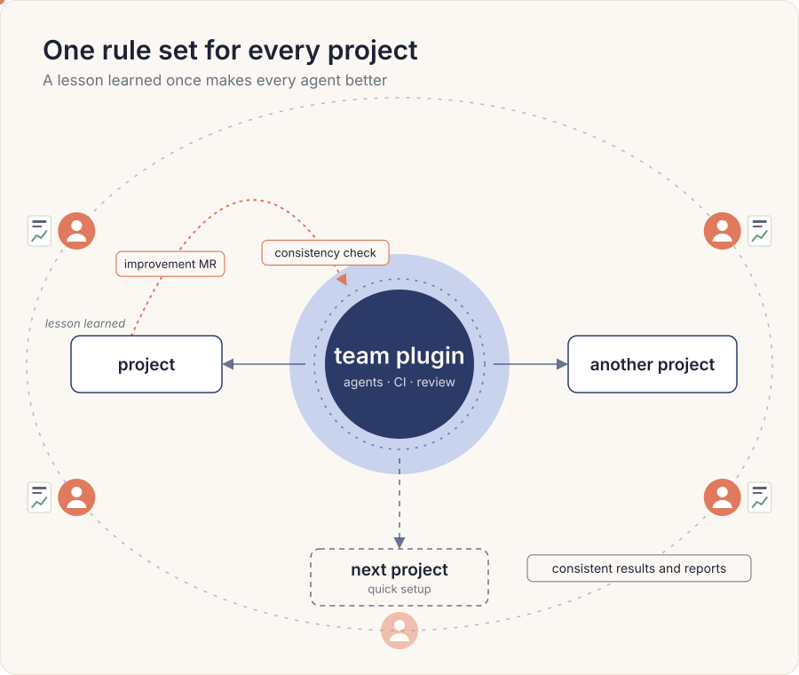

# Coding Agent Guidelines

This repository keeps my personal [guidelines](AGENTS.md) and [skills](skills/) for working with coding agents: how I plan work, coordinate parallel sessions, and grasp their reports at a glance. I value instructions I can read and refine, with clear steps and results I can review. They evolve as the models evolve.

To use them, import [AGENTS.md](AGENTS.md) from your `CLAUDE.md` or `AGENTS.md` and link the [skills](skills/) into your skills folder.

## Company Work

Most of the engineering guidelines and skills that began here now live in my company's private repository, where the whole team uses and improves them. There I am building:

- **Development standards:** common rules for how engineers write and check software across all company repositories.
- **Coding agent practices and tooling:** a shared plugin that gives every engineer's coding agent the same guidelines and skills, plus automated reviews of the agents' work.
- **Shared knowledge:** a company wiki maintained with LLMs and a log of solved problems, both searchable by people and agents.

## Quotes

> Code is cheap. Quality is not. The job of a software engineer has never really been about putting lines of code on the screen. It's been about architecting elegant solutions to complex problems, thinking 10 steps ahead about how a system will evolve, and retaining flexibility in the face of changing requirements.

*— Jonathan Kelley, Dioxus — AI Engineer World's Fair, July 2026*

> Intelligence is the ability to solve a problem. Now, in a world where intelligence has become very cheap and abundant, you can solve anything. What's the bottleneck? The bottleneck becomes the question: "Okay, what do I want to solve?" I can have anything I want. What do I want?

*— Yuval Noah Harari — EDP 50th Anniversary Gala Dinner, July 2026*
